# README variants

Previews only. The real profile README is unchanged. Toggle GitHub's light/dark theme to see both card themes.

Cards are a static snapshot. Regenerate on the VPS with:

```sh
node scripts/agent-stats.mjs > data/agent-stats.json
node scripts/github-stats.mjs > data/github-stats.json
node scripts/render.mjs
```

- [A. Agent-first](a-agent-first.md): Replaces the classic GitHub cards with agent activity, model mix and a 24/7 heatmap.
- [B. Terminal](b-terminal.md): Minimal: one animated terminal that types out agent and reach stats, then the reach card.
- [C. Full dashboard](c-dashboard.md): Keeps your current cards, adds reach and agent activity, with the details tucked into expandable sections.

## All cards

<p align="center">
<picture><source srcset="cards/agent-ops-dark.svg" media="(prefers-color-scheme: dark)"></picture>
</p>

<p align="center">
<picture><source srcset="cards/models-dark.svg" media="(prefers-color-scheme: dark)"></picture>
</p>

<p align="center">
<picture><source srcset="cards/tools-dark.svg" media="(prefers-color-scheme: dark)"></picture>
</p>

<p align="center">
<picture><source srcset="cards/heatmap-dark.svg" media="(prefers-color-scheme: dark)"></picture>
</p>

<p align="center">
<picture><source srcset="cards/reach-dark.svg" media="(prefers-color-scheme: dark)"></picture>
</p>

<p align="center">
<picture><source srcset="cards/terminal-dark.svg" media="(prefers-color-scheme: dark)"></picture>
</p>
