<!-- A. Agent-first: Replaces the classic GitHub cards with agent activity, model mix and a 24/7 heatmap. -->

<picture><source srcset="cards/agent-ops-dark.svg" media="(prefers-color-scheme: dark)"></picture>

<picture><source srcset="cards/models-dark.svg" media="(prefers-color-scheme: dark)"></picture>
<picture><source srcset="cards/tools-dark.svg" media="(prefers-color-scheme: dark)"></picture>

<picture><source srcset="cards/heatmap-dark.svg" media="(prefers-color-scheme: dark)"></picture>

 
Most of my substantial work is commissioned and kept private.

